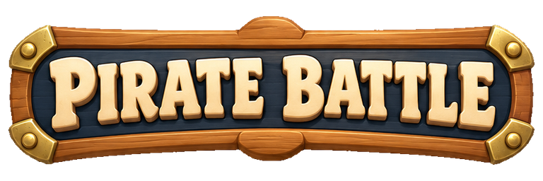
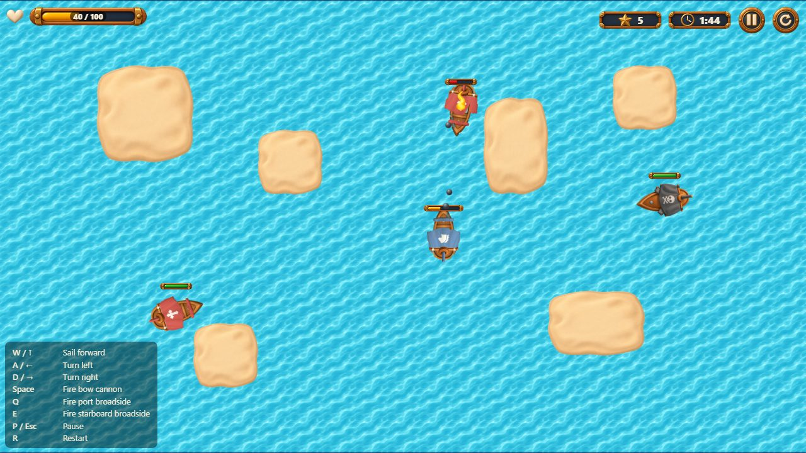
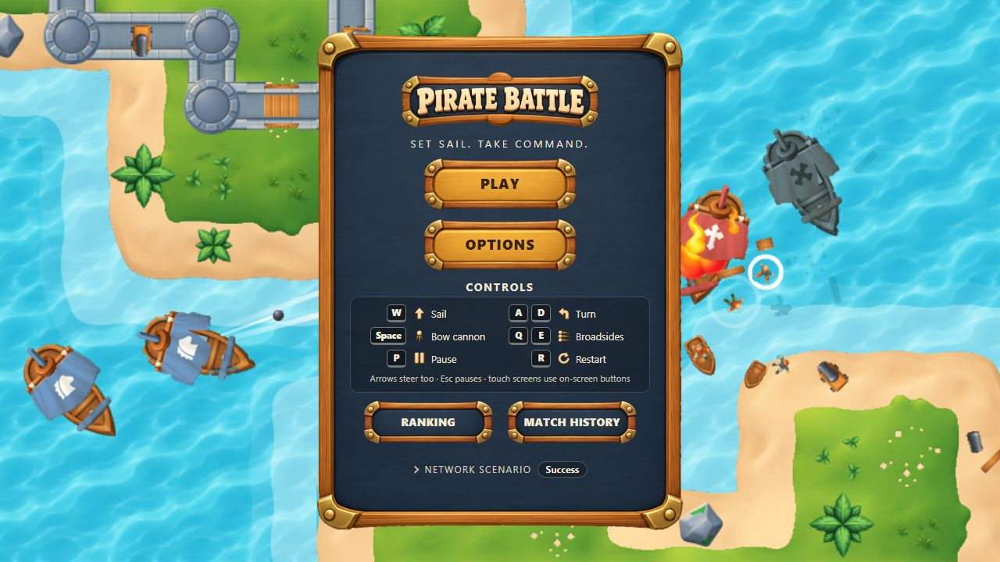
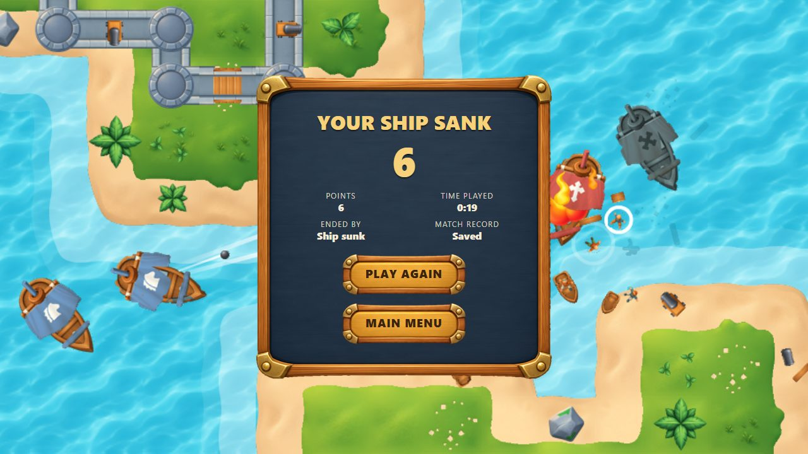
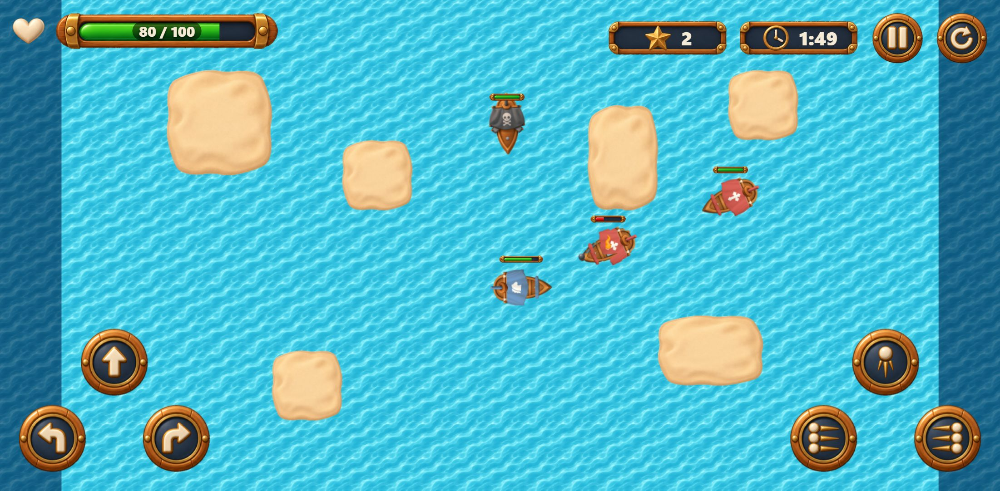
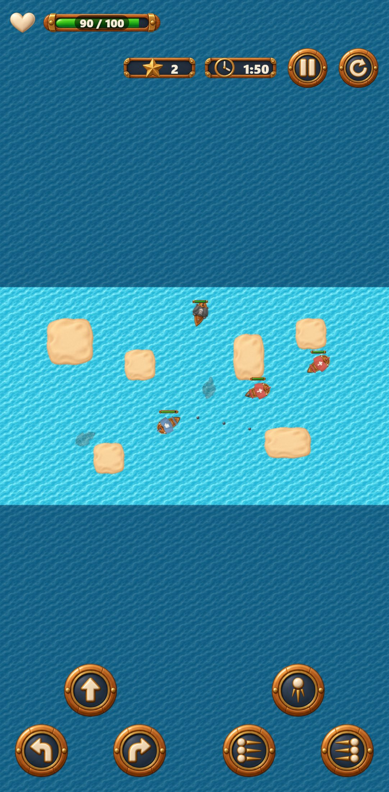

<p align="center">
  
</p>

<p align="center">
  A top-down 2D naval shooter: sail between islands, sink enemy ships and climb the ranking before
  the clock runs out.<br />
  Built with React, TypeScript and PixiJS.
</p>

<p align="center">
  <a href="https://gabriellopesweber-pirate-battle.vercel.app"><strong>▶ Play now</strong></a>
  &nbsp;·&nbsp;
  <a href="ARCHITECTURE.md">Architecture</a>
  &nbsp;·&nbsp;
  <a href="#network-scenarios">Break the network</a>
</p>

<p align="center">
  <a href="https://github.com/gabriellopesweber/pirate-battle/actions/workflows/ci.yml"></a>
  <a href="https://gabriellopesweber-pirate-battle.vercel.app"></a>
</p>

<p align="center">
  
</p>

<table align="center">
  <tr>
    <td align="center"><br /><sub>Main menu</sub></td>
    <td align="center"><br /><sub>Result, registered</sub></td>
    <td align="center"><br /><sub>Phone, on its side</sub></td>
    <td align="center"><br /><sub>Upright</sub></td>
  </tr>
</table>

## Contents

[Stack](#stack) · [Setup](#setup) · [Commands](#commands) · [Controls](#controls) · [Devices and orientation](#devices-and-orientation) · [Gameplay configuration](#gameplay-configuration) · [Network scenarios](#network-scenarios) · [Environment variables](#environment-variables) · [How this was built](#how-this-was-built) · [Documentation](#documentation)

## Stack

| Concern | Technology |
|---|---|
| UI and menus | React 19 |
| Language | TypeScript (strict) |
| Game rendering | PixiJS 8 |
| Remote state (ranking, history) | TanStack Query 5 |
| HTTP client | Axios |
| API mocking | MSW |
| E2E and visual regression | Playwright |
| Unit and component tests | Vitest + Testing Library |
| Build | Vite |

## Setup

Requirements: Node.js 22–24 (CI and production run 24) and pnpm 11.

```bash
pnpm install
pnpm dev
```

Optionally copy `.env.example` to `.env` — the defaults work out of the box. Nothing else is
needed: the ranking and history API is mocked in the browser (see *Network scenarios*), so a clean
checkout runs without any private service.

## Commands

| Command | What it does |
|---|---|
| `pnpm dev` | Generate runtime assets, then start the development server |
| `pnpm assets` | Regenerate `public/game/` from `assets/` (run by `dev` and `build`) |
| `pnpm build` | Type-check and production build |
| `pnpm preview` | Serve the production build |
| `pnpm lint` | ESLint |
| `pnpm typecheck` | TypeScript, no emit |
| `pnpm test` | Unit and component tests (Vitest) |
| `pnpm test:e2e` | Playwright, desktop and mobile Chromium |
| `pnpm test:e2e:update` | Refresh visual baselines (on Linux; see below) |
| `pnpm test:e2e:report` | Open the last HTML report |
| `pnpm check` | lint + typecheck + unit + build |
| `pnpm profile` | Performance profile of the production build in Chrome (after `pnpm build`) — see [`docs/performance/`](docs/performance) |

**Tests.** Unit and component tests (Vitest) live next to the code, in `src/**/test/`. The
Playwright suite in `tests/e2e/` runs against the production build, on desktop and mobile Chromium;
failures leave an HTML report (`pnpm test:e2e:report`) and a trace. Gameplay tests drive the real
keyboard on a match whose clock and seed they control — open `/?test&clock=manual&matchSeed=7` to
see what they see (`window.__pirateBattle.state()`, `window.__pirateBattle.step(1)`); see
`ARCHITECTURE.md` → *Browser-test instrumentation*.

**Test report.** Every run writes an HTML report to `playwright-report/`; a failing test keeps its
trace (each step with the page, network and console) and a screenshot. Locally, `pnpm test:e2e`
then `pnpm test:e2e:report`. In CI, every run publishes the report as the `playwright-report`
artifact (Actions → the run → *Artifacts*, kept 14 days); unzip it and open it with
`pnpm exec playwright show-report <folder>` — the traces open from the report.

**Visual baselines.** The menu, the arena at the start of a seeded match and the result screen are
compared against screenshots in `tests/e2e/__screenshots__/`, rendered on Linux in the official
Playwright image — the same one CI runs the suite in. Fonts and software WebGL differ on other
systems, so there these three tests are skipped. To refresh the baselines from any machine with
Docker (the second volume keeps the container's `node_modules` apart from the host's):

```sh
docker run --rm --ipc=host -v "$PWD:/work" -v /work/node_modules -w /work \
  mcr.microsoft.com/playwright:v1.64.0-noble \
  bash -c "corepack enable && pnpm install --frozen-lockfile && pnpm test:e2e:update tests/e2e/visual.spec.ts"
```

## Controls

| Action | Keyboard | Touch |
|---|---|---|
| Sail forward | `W` / `↑` | forward button |
| Turn left / right | `A` / `←`, `D` / `→` | turn buttons |
| Fire bow cannon | `Space` | bow-cannon button |
| Fire port / starboard broadside | `Q` / `E` | broadside buttons |
| Pause | `P` / `Esc` | Pause button |
| Restart | `R` | Restart button |

Moving and firing work together. Game keys are only captured while a match is running; the
match also pauses on its own when the window loses focus or the tab is hidden. Touch buttons show
on touch screens as two thumb clusters — steering bottom left, weapons bottom right; keyboard
controls are listed on screen.

## Devices and orientation

Desktop and mobile, in **both orientations** on a phone. Upright, the arena keeps its proportions
(it is wider than tall), so it sits in the middle with a darker sea around it — the edge where
ships stop stays visible — and the HUD wraps to two rows. On its side, menus switch to a compact
layout so every main action shows without scrolling, down to 568 × 320. Turning the device mid-match
re-fits the view; the rules do not change.

**Accessibility:** menus work from the keyboard alone, with a visible focus ring; the pause dialog
keeps focus inside it and gives it back when closed; the score tabs move with the arrow keys. Score,
time and match state are also read out by a live region — on the start, pause, resume, each point
and at 1 min / 30 s / 10 s left, never per frame. Text contrast was measured against the rendered
pixels (see `ARCHITECTURE.md` → *Accessibility*).

## Gameplay configuration

All balancing numbers live in [`src/game/config/gameConfig.ts`](src/game/config/gameConfig.ts).
The Options screen exposes two of them:

| Option | Default | Limits |
|---|---|---|
| Game session time | 120 s | 60–180 s |
| Enemy spawn time | 3 s | 1–10 s |

Below 1 s the arena fills up to the alive-enemy cap within seconds; above 10 s a short match may
not show both enemy types. Each match uses a snapshot of the options taken when it starts.

## Network scenarios

The ranking and history API is a mock served by MSW — in development and in the deployed build. Its
network conditions are selectable, so every failure the game handles can be reproduced on demand.

**Selecting one:** open **Network scenario** at the foot of the main menu and pick from the list,
or put it in the URL — `?scenario=offline`, optionally with `&seed=42` for the randomness of the
variable latency. The choice is kept across refreshes, and the panel shows the active scenario even
when collapsed. A change applies at once: both tabs refetch and pending registrations are resent.

**Resetting:** **Reset data** in the same panel restores the fixtures and the Success scenario,
clears confirmed and pending registrations and the last result, and reloads.

| Scenario | URL value | What happens |
|---|---|---|
| Success | `success` | Every request answers at once; the ranking has several pages |
| Empty lists | `empty` | Ranking and history answer with no matches |
| Slow | `slow` | Every answer takes about two seconds |
| Variable latency | `jitter` | Each answer takes 0.1–1.5 s, drawn from the seed |
| Out-of-order answers | `out-of-order` | Each read answers after the one sent next |
| Timeout | `timeout` | Every answer arrives after the client's 5 s timeout |
| Connection failure | `offline` | Every request fails to reach the server |
| Server error (500) | `server-error` | Every request gets a 500 |
| Rejected request (400) | `bad-request` | Every request gets a 400 |
| Ranking fails | `ranking-fails` | Only the ranking answers with a 500 |
| History fails | `history-fails` | Only the match history answers with a 500 |
| Timeout after registering | `register-timeout` | The server stores a match but answers its first send too late; resends recover it without a duplicate |
| Unavailable at match end | `register-offline` | Registering fails; the match stays pending until you switch back to Success |

**Reproducing the failures the brief lists:**

- *Ranking or history read failure, loading and retry:* `history-fails` or `ranking-fails`, then
  open the tab — the error explains itself and offers **Try again**; switching back to Success
  recovers
- *Late answers never overwrite newer data:* `out-of-order`, then page through the ranking
- *Timeout after registering, without duplication:* `register-timeout`, then finish a match — the
  result shows **Saved** and the history holds one entry
- *Unavailable at match end, registered after recovery:* `register-offline`, finish a match (the
  result shows it is not saved), then pick Success in the menu — the pending match is sent

## Environment variables

| Variable | Default | Purpose |
|---|---|---|
| `VITE_API_BASE_URL` | `/api` | Base URL for the ranking and history API (served by MSW) |

## How this was built

**The process came first.** Before any game code, the brief became a delivery plan
([`docs/plans/in-progress/delivery.md`](docs/plans/in-progress/delivery.md)) and an epic with one
issue per deliverable, and the rules of the work were written down in
[`CONTRIBUTING.md`](CONTRIBUTING.md):

- **The brief is the scope.** Nothing goes in without a requirement asking for it; what gets cut
  is written down, never dropped silently.
- **Priority is consequence, not effort** — `p1` playable, deployed and within the mandatory
  rules; `p2` what the evaluation checks; `p3` polish — so the order of work follows the brief's
  scoring.
- **Plans become issues before code**, one branch and one pull request per issue. A defect found
  along the way gets its own issue, never a silent fix inside another change.
- **Tests first**, at the right layer: unit tests for the rules, component tests for UI states,
  Playwright for the brief's flows; test doubles only at the edges.
- **Gates:** `pnpm check` and the whole E2E suite before every pull request, CI on every pull
  request, merge only when green.

**Within those rules**, the code was written with [Claude Code](https://claude.com/claude-code),
Anthropic's coding agent, as a pair programmer. The agent wrote most of the code and tests; the
author planned each issue, made the calls that were his to make (the order of the work, what to
cut, the supported orientation, how the game should look), reviewed and approved every commit
before it was made, and checked the game in the browser on desktop and phone sizes. Every commit
carries a `Co-Authored-By: Claude` trailer, so the history says it plainly. The reasons behind each
decision are in `ARCHITECTURE.md`, the plan and the pull requests.

## Documentation

- [`ARCHITECTURE.md`](ARCHITECTURE.md) — how the game is put together and why
- [`assets/README.md`](assets/README.md) — where the art and sound come from, their license, and
  what the build derives from them
- [`docs/performance/`](docs/performance) — performance report: 120 FPS (p95 8.6 ms) in a
  three-minute match and at the densest spawning, memory across 15 match cycles, raw data
- [`CONTRIBUTING.md`](CONTRIBUTING.md) — workflow: issues, branches, commits, pull requests
- [`docs/plans/`](docs/plans) — delivery plan and its status
